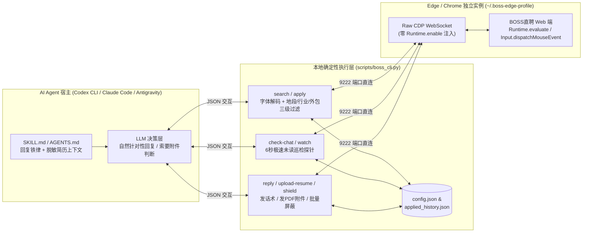

# boss-zhipin-agent 🤖💼

> **面向 OpenAI Codex CLI / Claude Code / Google Antigravity 的 BOSS直聘求职与消息巡检 Agent 技能包（Skill + Raw CDP CLI）**

[](./LICENSE)
[](https://www.python.org/)
[](./SKILL.md)

`boss-zhipin-agent` 是一套专为 AI Coding Agent（如 **OpenAI Codex CLI**、**Claude Code**、**Google Antigravity**）设计的本地求职自动化工具与 Skill。它采用**零 Playwright 依赖的原生 Chrome DevTools Protocol (CDP) WebSocket 直连架构**，彻底绕过 BOSS直聘前端针对 `Runtime.enable` 的自动化反爬闪退检测，支持：

- 🔍 **私有字体反爬解码与多维过滤**：自动还原 BOSS直聘搜索页的 Unicode 私用区加密薪资数字（`\ue031`–`\ue03a`），支持按薪资重叠区间、公司黑名单、行业黑名单、办公地段/园区黑名单、驻场/外包过滤并持久化去重（`applied_history.json`）。
- 📨 **低频定量批次投递**：支持每天定时定量（如早晚各 5 家）自动打开岗位详情页复核地址与 JD、点击「立即沟通」，并以**候选人 AI 助手**身份发送高匹配度自荐语。
- ⚡ **6 秒极速消息巡检探针（Deterministic Probe + LLM-in-the-Loop）**：日常巡检仅需 6 秒钟即可扫完最近聊天列表，自动忽略外包群发与系统拒信；**仅当目标招聘官发来新消息时**才唤醒大模型结合脱敏简历生成自然、谦逊、针对性的回复。
- 📎 **硬件级鼠标事件操控弹窗**：通过 `Input.dispatchMouseEvent` 与 `DOM.setFileInputFiles`，稳定支持上传本地脱敏 PDF 简历、在聊天窗口点开 `发简历` 弹窗发送指定 PDF 附件、以及在隐私设置页批量勾选并屏蔽指定公司。

---

## 🏗️ 架构原理



### 为什么不用 Playwright / Selenium？
BOSS直聘前端对 WebDriver 及 Playwright 的 `connect_over_cdp` 有严格检测：Playwright 连接时会默认向所有 Frame 广播 `Runtime.enable` 与初始化注入脚本，一旦在页面上触发点击（如点“立即沟通”或“发送”），标签页会立刻被前端安全脚本强制关闭（`Target closed`）。

本项目通过 `aiohttp` 直接连接浏览器标签页的原生 `webSocketDebuggerUrl`，**按需仅调用 4 个干净的底层原语**（`Runtime.evaluate`、`Input.insertText`、`Input.dispatchMouseEvent`、`DOM.setFileInputFiles`），无任何全局 Hook 注入，稳定可靠。

---

## 🚀 快速开始

### 1. 安装依赖
仅需 Python 3.9+ 及 `aiohttp`：
```bash
git clone https://github.com/icaikun/boss-zhipin-agent.git
cd boss-zhipin-agent
pip install -r requirements.txt
```

### 2. 初始化个人配置（本地保存，已被 `.gitignore` 忽略）
```bash
cp config.example.json config.json
```
编辑 `config.json`，填入你的**脱敏简历核心事实**（`candidate.resume_facts`）、期望城市与薪资区间（`target`）、以及需要避开的公司/行业/办公地段（`filters`）。

### 3. 首次扫码登录（持久化保存 Cookie）
```bash
python scripts/boss_cli.py login
```
在弹出的独立 Edge/Chrome 窗口中扫码登录 BOSS直聘，登录成功后直接关闭窗口即可（登录态永久保存在 `~/.boss-edge-profile`）。

---

## 🛠️ 在不同 Agent 中安装使用

### 方式 A：在 OpenAI Codex CLI 中使用
1. **作为全局 Skill 安装**：
   ```bash
   mkdir -p ~/.codex/skills
   cp -r ../boss-zhipin-agent ~/.codex/skills/boss-zhipin-agent
   ```
2. **或者直接在仓库目录下启动 `codex`**（会自动加载仓库根目录的 [`AGENTS.md`](./AGENTS.md)）：
   ```bash
   codex "帮我检查一下 BOSS 直聘有没有新的 HR 回复，有的话根据我的脱敏简历自然回复；如果是索要简历就发默认方向的 PDF 附件"
   ```
3. **开启全自动日间后台巡检（检测到新回复自动唤醒 `codex exec`）**：
   ```bash
   python scripts/boss_cli.py watch --codex-hook
   ```

### 方式 B：在 Claude Code / Google Antigravity 中使用
将本仓库复制到对应的 Skills 目录即可自动识别 [`SKILL.md`](./SKILL.md)：
- **Claude Code**：`~/.claude/skills/boss-zhipin-agent`
- **Google Antigravity**：`~/.gemini/config/skills/boss-zhipin-agent`

---

## 📋 命令行工具 (`boss_cli.py`) 速查表

| 子命令 | 示例命令 | 功能说明 |
| :--- | :--- | :--- |
| `login` | `python scripts/boss_cli.py login` | 启动独立浏览器 Profile 扫码登录 |
| `upload-resume` | `python scripts/boss_cli.py upload-resume --file ./resume.pdf` | 上传本地脱敏 PDF 简历至 BOSS直聘附件列表 |
| `shield` | `python scripts/boss_cli.py shield --add "某公司A" "某公司B"` | 在隐私设置页自动搜索并批量勾选屏蔽指定公司 |
| `search` | `python scripts/boss_cli.py search --limit 10` | 解密薪资字体并按黑名单/薪资/经验筛选匹配岗位 |
| `apply` | `python scripts/boss_cli.py apply --limit 5` | 进详情页复核地址与 JD 后发起沟通并发送 AI 助手自荐语 |
| `check-chat` | `python scripts/boss_cli.py check-chat` | 6 秒极速扫描聊天列表，输出包含 `new_replies` 的 JSON |
| `reply` | `python scripts/boss_cli.py reply --company "某科技" --text "您好..." --send-resume "个人简历"` | 向指定招聘官发送自然文本回复，并可选发送已上传的 PDF 附件 |
| `watch` | `python scripts/boss_cli.py watch --codex-hook` | 在设定的日间时段（如 `08:00–23:00`）定期巡检新消息 |

---

## 🛡️ 隐私与安全设计原则

1. **零个人信息入库**：`.gitignore` 默认排除了 `config.json`、`applied_history.json`、所有 `.pdf/.docx` 简历文件以及浏览器 Profile，确保不会将任何个人隐私提交到 Git 仓库。
2. **脱敏简历与边界护栏**：推荐始终上传并使用**脱敏版简历**（隐去真实姓名全称、个人免冠照片与现东家/前东家敏感全称），并在 `SKILL.md` 中严格约束 Agent **只允许回答脱敏简历上写明的客观事实，绝不编造简历外信息**。
3. **温和频率控制**：建议每天批次投递不超过 2 次（每次 5 家左右），日间巡检间隔不少于 30 分钟，避免高频请求触发风控。

---

## 📄 License
[MIT License](./LICENSE)
